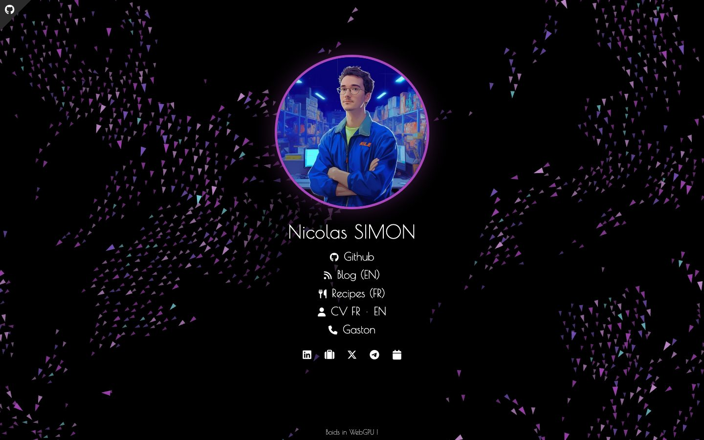
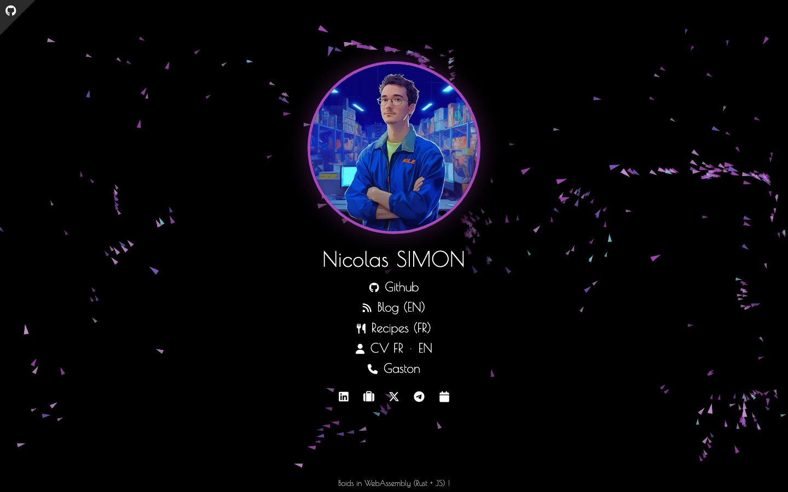

# Boids background

The flock of birds behind [nsimon.fr](https://nsimon.fr), based on [Craig Reynolds' boids](https://www.red3d.com/cwr/boids/). It has two implementations: [`index.js`](../index.js) uses WebGPU when the browser supports it and falls back to WebAssembly otherwise.

| | Project | Runs on | Used when |
|---|---|---|---|
| **WebGPU** | [nSimonFR/webgpu-boids](https://github.com/nSimonFR/webgpu-boids) ([demo](https://nsimonfr.github.io/webgpu-boids/)) | GPU compute shaders (WGSL) | the browser exposes WebGPU |
| **WebAssembly** | [nSimonFR/wasm-boids](https://github.com/nSimonFR/wasm-boids) ([npm](https://www.npmjs.com/package/wasm-boids)) | Rust compiled to WASM, drawn with [PixiJS](https://pixijs.com/) | fallback, or forced with [`?wasm`](https://nsimon.fr/?wasm) |

## WebGPU



About 1 boid per 900 CSS px² (up to 2,000), all simulated on the GPU. The site bundles its own copy of [webgpu-boids](https://github.com/nSimonFR/webgpu-boids) instead of embedding it in an iframe, so it starts without a flash and reacts to the pointer.

- [`webgpu.js`](webgpu.js): device setup, ping-pong buffers, MSAA render loop
- [`shaders/compute.wgsl`](shaders/compute.wgsl): flocking. Separation, alignment and cohesion, with a capped turn rate, field of view, smooth neighbour falloff, density control (no dense clumps), 4 hidden flocks that weave instead of fusing, a held cruise speed, gentle wander and pointer avoidance
- [`shaders/render.wgsl`](shaders/render.wgsl): dart shape and a fixed per-boid colour from a muted palette

## WebAssembly



The simulation comes from the [`wasm-boids`](https://github.com/nSimonFR/wasm-boids) Rust crate. [`wasm.js`](wasm.js) draws it with PixiJS, with fewer boids (up to 500) because it runs on the CPU.

## Shared

[`common.js`](common.js) holds what both backgrounds share:
- **Density-based count:** the number of boids scales with screen size, so phones get a few hundred.
- **Calm spawn:** boids start spread across the screen and already flying roughly the same way.
- **Palette:** fixed colours that match the site's accent.
- **Fade-in:** the background fades in instead of popping in.
- **Photosensitivity:** colours never change from frame to frame, so there is no strobing.
- **Reduced motion:** with `prefers-reduced-motion`, the flock forms off-screen and the page shows a single still frame.

## Development

```sh
npm run website:vite          # from the repo root: dev server
npm run test:flock            # from nsimon.fr/: long-run flock check (needs Google Chrome)
```

`test:flock` runs 5 simulated minutes at desktop, laptop and phone sizes. It uses `window.__boids`, a hook that only exists in dev builds. The check fails if boids clump, overlap, slow down or merge into a single flock.
